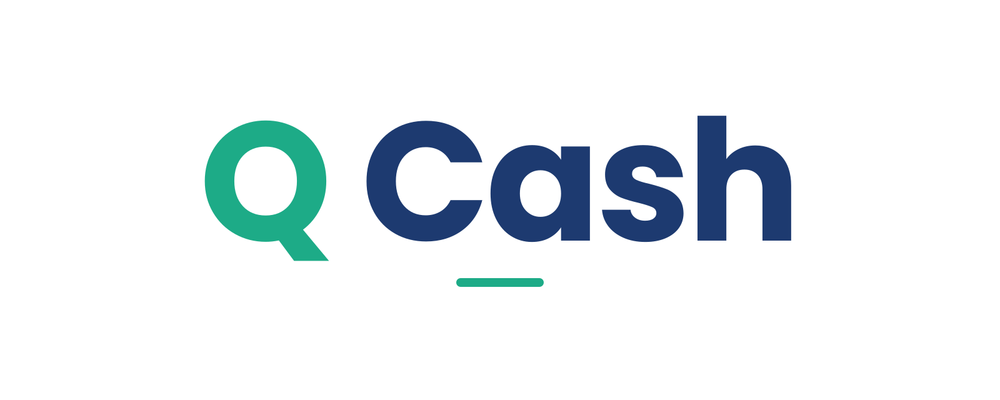
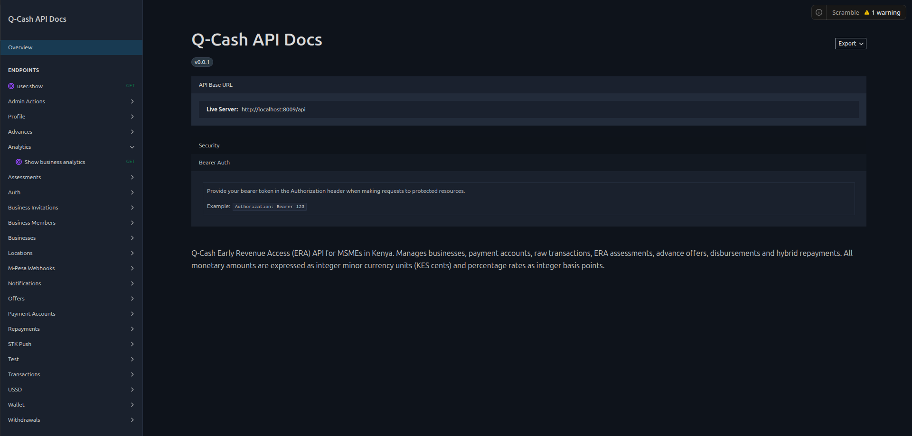

<p align="center">
  
</p>

<h1 align="center">QCash Backend</h1>

<p align="center">
  Early Revenue Access (ERA) API for Kenyan MSMEs — businesses, payments, assessments,
  cash advances, repayments, wallets, notifications and USSD.
</p>

<p align="center">
  
  
  
  
</p>

## API Platform

The API reference is generated with [Scramble](https://scramble.dedoc.co) and served locally at
[`/docs/api`](http://localhost:8000/docs/api). The raw OpenAPI document is available at
[`/docs/api.json`](http://localhost:8000/docs/api.json).

<p align="center">
  
</p>

### Accessing the docs

```bash
php artisan serve
```

Then open **http://localhost:8000/docs/api**. The docs are restricted outside local/development
environments; see `config/scramble.php` for the middleware and branding options.

## What this app does

- Business onboarding, members, invitations, locations and KYC status
- Payment account and raw transaction ingestion
- Transaction classification and business analytics
- ERA assessments via the Python ML decision API
- Advance offers, approval, wallet disbursement and exposure controls
- Hybrid repayments: automatic revenue deductions, QCash wallet and M-Pesa STK
- Business wallet, withdrawals and M-Pesa B2C reconciliation
- SMS and in-app notifications
- Africa's Talking USSD for owners (collect payment, check/borrow advance, withdraw)
- M-Pesa webhooks for C2B, STK push and B2C

## Tech stack

- PHP 8.3 / Laravel 13
- PostgreSQL (SQLite for tests)
- Laravel Sanctum for API tokens
- Scramble for OpenAPI documentation
- Pest for testing, Pint for formatting
- Docker support

## Getting started

### Requirements

- PHP 8.3+
- Composer
- PostgreSQL
- Node.js and npm (only if you work on the welcome page/assets)

### Install

```bash
composer install
cp .env.example .env
php artisan key:generate
```

Configure the database and integrations in `.env`, then:

```bash
php artisan migrate --seed
php artisan serve
```

The seeder creates demo businesses, users, transactions, assessments and advances.

### Environment highlights

| Variable | Purpose |
|---|---|
| `APP_URL` | Base URL used to derive webhook callbacks |
| `DB_*` | PostgreSQL connection |
| `MPESA_*` | Daraja C2B, STK push and B2C credentials |
| `AFRICASTALKING_*` | SMS and USSD channel settings |
| `QCASH_ML_API_URL` | Python ERA assessment service |
| `ACCESS_FEE_BPS` | Access fee on borrowing (default `200` = 2%) |
| `REPAYMENT_MAXIMUM_DAYS` | Repayment window (default `30` days) |
| `REPAYMENT_DAILY_CAP_MINOR` | Automatic deduction daily cap |

See `.env.example` for the complete list. For local webhooks and USSD, expose the app with
ngrok/cloudflared and set `APP_URL` to the public HTTPS URL.

## Authentication

```text
POST /api/auth/register        Create an account by phone number
POST /api/auth/verify-phone    Verify the OTP and receive a Sanctum token
```

Send the token on protected routes:

```http
Authorization: Bearer <token>
Accept: application/json
```

Admin endpoints live under `/api/admin/*` and require an activated admin account.

## Core API areas

| Area | Examples |
|---|---|
| Auth & profile | `/api/auth/*`, `/api/user` |
| Businesses | `/api/businesses`, members, invitations, payment accounts |
| Transactions | `/api/businesses/{business}/transactions`, analytics |
| Assessments | `/api/businesses/{business}/assessments` |
| Advances | `/api/businesses/{business}/offers`, `/api/offers/{offer}/accept`, `/api/advances/*` |
| Wallet | `/api/businesses/{business}/wallet`, `/withdrawals` |
| Repayments | `/api/businesses/{business}/repayments`, `/wallet`, `/mpesa` |
| Notifications | `/api/notifications` |
| Locations | `/api/locations/*` |
| Webhooks | `/api/webhooks/*` (M-Pesa C2B, STK, B2C) |
| USSD | `/api/webhooks/ussd` (Africa's Talking callback) |

## Domain rules

- All monetary values are integer **minor units** (KES cents). Rates are integer **basis points**.
- Borrowing charges a **2% access fee**: the wallet receives `requested − fee`, and the borrower
  repays the full requested amount.
- New advances run for a maximum of **30 days**.
- The exposure cap is the assessment's approved advance amount; available borrowing is
  `approved amount − outstanding committed exposure`. Pending, approved, disbursing, active and
  overdue advances all count.
- Automatic repayment collects a percentage of eligible inflow receipts, subject to a daily cap
  and a working-capital floor, and repays the fee before principal.
- Advance disbursements are credited directly to the business QCash wallet.

## Testing and formatting

```bash
php artisan test --compact
vendor/bin/pint --dirty --format agent
```

Tests use an in-memory SQLite database. Feature tests cover authentication, businesses,
transactions, assessments, offers, disbursements, repayments, exposure, notifications, webhooks
and USSD.

## Docker

Deployment files and instructions live in `Dockerfile`, `compose.yml`, `compose.prod.yml` and
`DOCKER_DEPLOYMENT.md`.

## Project structure

```text
app/
  Http/Controllers/   API, admin and webhook controllers
  Models/             Eloquent models
  Services/           Domain services (advances, repayments, wallets, USSD, M-Pesa, ...)
  Notifications/      In-app notifications
config/               App, services and repayment configuration
database/             Migrations, factories and seeders
routes/api.php        API and webhook routes
tests/Feature/        Feature tests
```
